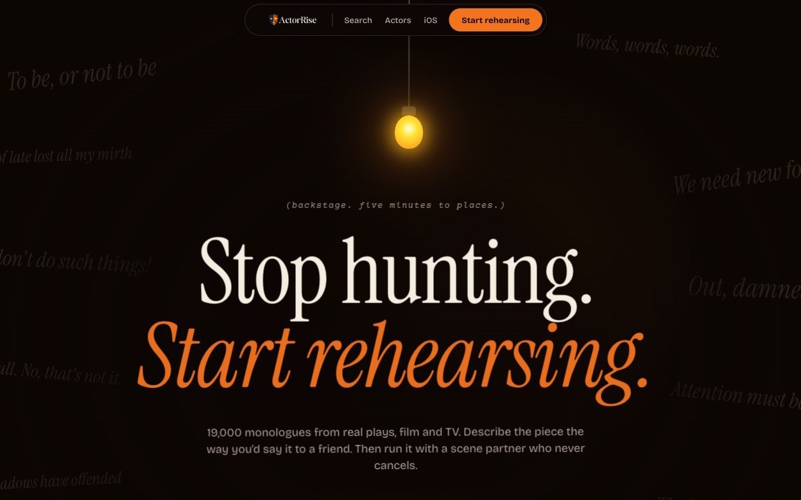

<picture>
  <source media="(prefers-color-scheme: dark)" srcset="assets/header-dark.svg">
  
</picture>

 

I'm a full-stack engineer and a working actor. I spent almost three years at Prevail Legal AI building transcript search, video sync and permissions for 50+ law firms. Now I build my own products end to end, from the database to the App Store.

[Portfolio](https://canberkvarli.is-a.dev) · [ActorRise](https://www.actorrise.com) · [LinkedIn](https://www.linkedin.com/in/canberkvarli) · [X](https://x.com/canberkvarli) · [Email](mailto:canberkvarli@gmail.com)

 

## Now building

**[ActorRise](https://www.actorrise.com)** is AI search and rehearsal for actors. You describe the monologue you need in plain English and get real matches from 19,000+ pieces. Then you rehearse it with ScenePartner, a voice partner that waits for your cue.

| 1,200+ | 19k+ | web + iOS |
| :-- | :-- | :-- |
| signups | monologues indexed | one backend |

- **Hybrid search.** pgvector embeddings plus trigram text search. The AI finds pieces but never writes or changes the source text.
- **ScenePartner.** A voice rehearsal partner that waits for your cue line.
- **[Ghost Light](https://apps.apple.com/us/app/ghost-light-monologues/id6804278673).** The iOS app, with offline saves for when you're in the wings with no signal.
- **Production ETL.** Scraping, monologue extraction, AI content analysis and batch embeddings.

 

## Stack

| Layer | What I reach for |
| :-- | :-- |
| **Frontend** | `TypeScript` `React` `Next.js` `Tailwind` |
| **Mobile** | `React Native` `Expo` `Firebase` |
| **Backend** | `Python` `FastAPI` `Ruby on Rails` |
| **Data & AI** | `Postgres` `pgvector` `Supabase` `Redis` `RAG / LLMs` `Whisper` |
| **Infra** | `Vercel` `AWS` `Docker` `Stripe` |

 

## Shipped

| When | What | |
| :-- | :-- | :-- |
| 2026 → now | **[ActorRise](https://www.actorrise.com)** · founder and engineer | Next.js · FastAPI · pgvector |
| 2026 | **[Ghost Light](https://apps.apple.com/us/app/ghost-light-monologues/id6804278673)** · ActorRise on iOS | React Native · Expo |
| 2024–2025 | **[fullcircle](https://apps.apple.com/us/app/fullcircle-wellness-community/id6753990519)** · wellness community app | React Native · Firebase · Stripe |
| 2021–2024 | **Prevail Legal AI** · transcript search 3× faster, case prep time cut 40% | Rails · AWS |
| 2017 | **Microsoft** · intern, cross-platform mobile app | Xamarin |

 

## Off the keyboard

Four productions with Inferno Theater in Berkeley, two as lead. Private pilot training in Budapest. Usually somewhere near the ocean.
